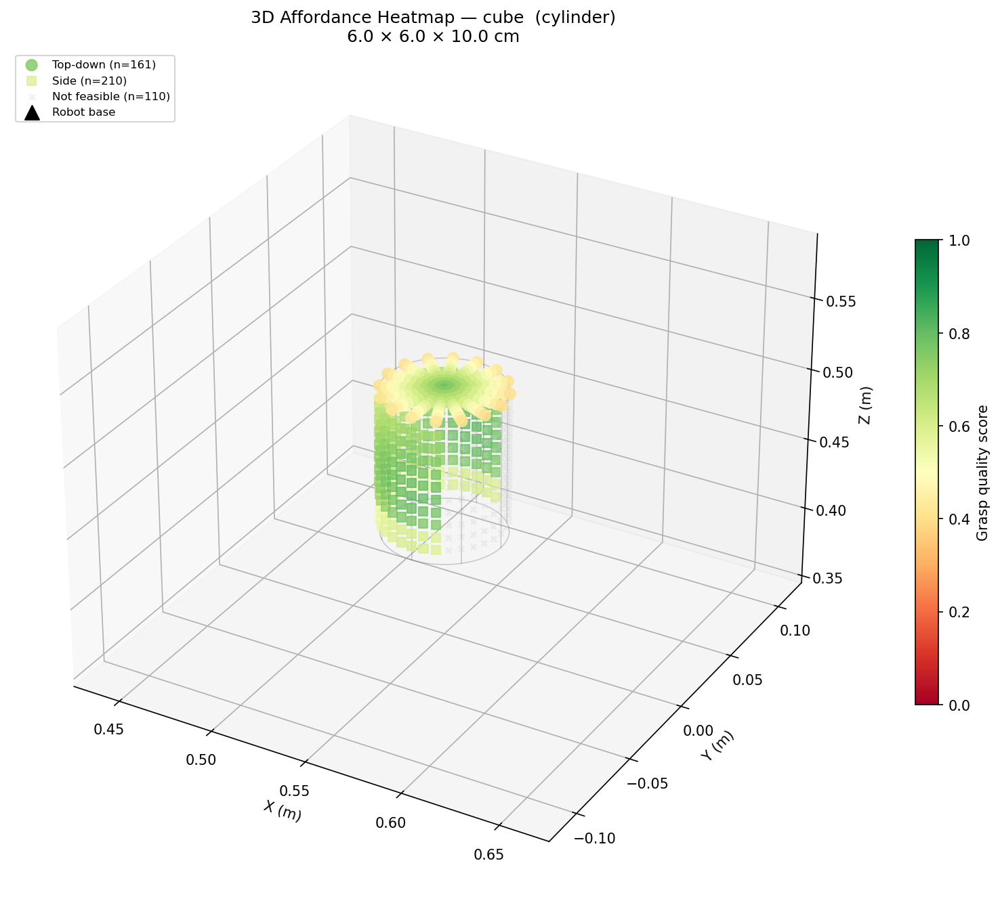
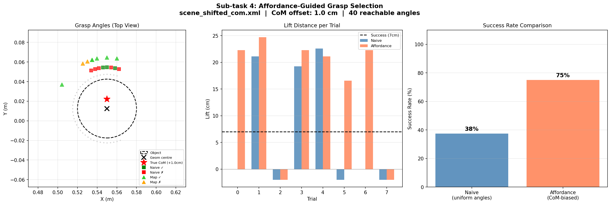

# Affordance-Aware Grasping for a Franka Panda Arm (MuJoCo)

Final-year project, BSc Computer Science, University of Leeds (2026).

A robot that only looks at an object's shape will often grab it in the wrong place: it might
hold a box off-centre and drop it when it lifts. This project builds **affordance maps** that
score where an object should be grasped, and uses them to choose better grasps for a 7-joint
**Franka Panda** arm with a parallel-jaw gripper, simulated in **MuJoCo**.



## Results

I compared two grasp planners on the same objects, with the same reachable approach angles:

- **Naive:** grasps at the object's geometric centre, at a random reachable angle
- **Affordance-guided:** grasps toward the object's true centre of mass, at a scored height

Each planner ran 8 trials per scene, across 5 scenes (40 trials each).

| Scene | Naive success | Affordance-guided success | Extra lift (cm) |
|---|---|---|---|
| Cube, centred | 50.0% | 75.0% | +9.0 |
| Cylinder | 50.0% | 87.5% | +10.3 |
| Tall box | 12.5% | 62.5% | +10.8 |
| Shifted centre of mass | 25.0% | 87.5% | +13.3 |
| Bottle | 25.0% | 25.0% | −0.2 |
| **Overall** | **32.5%** (13/40) | **67.5%** (27/40) | **+8.6 avg** |

The affordance-guided planner roughly **doubled grasp success** overall. The biggest gain was on
objects whose centre of mass is not at their geometric centre. The bottle showed no improvement;
most of its failures were the object slipping during side grasps.



## How it works

1. **Analytical affordance map** (`grasp_affordance_heatmap.py`): samples contact points over the
   object's surface and scores each one by reachability, force closure and clearance, then renders
   2D, 3D and on-mesh heatmaps.
2. **Empirical affordance map** (`empirical_grasp_sampler.py`, `run_empirical_trial.py`): runs each
   sampled grasp as a physical trial in simulation and records how far the object was lifted.
3. **Comparison** (`affordance_guided_comparison.py`): reads the true centre of mass from MuJoCo,
   filters to reachable approach angles, then runs the naive and affordance-guided planners
   side by side and saves plots and JSON results.

## Run it

```bash
git clone --recurse-submodules https://github.com/rickywchen/final_project.git
cd final_project
pip install -r requirements.txt

python scripts/affordance_guided_comparison.py   # naive vs affordance-guided trials
python scripts/build_comparison_summary.py       # overall summary table
python scripts/run_empirical_trial.py --scene bottle
```

Results are written to `outputs/` and `results/`.

## Tech

Python · MuJoCo · NumPy · SciPy · trimesh · OpenCV · Matplotlib

Robot and object models: [MuJoCo Menagerie](https://github.com/google-deepmind/mujoco_menagerie)
(Franka Panda) and the YCB object set, included as submodules.

## Notes

- Early in the project I also experimented with a multi-fingered robotic hand, before focusing on
  the Panda's parallel-jaw gripper.
- Small sample size (8 trials per planner per scene). Results are from simulation only.
